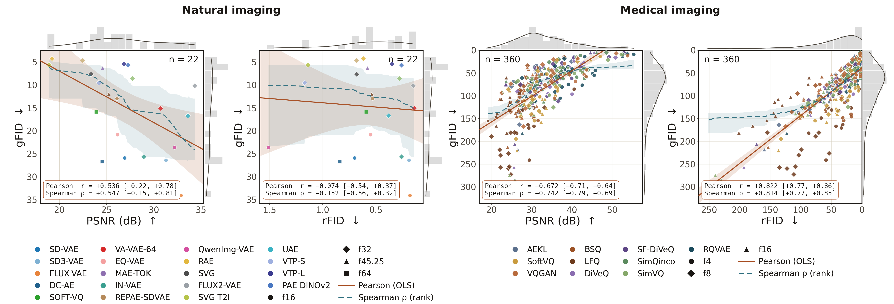

<h1 align="center">What Makes a Good Medical Image Tokenizer?</h1>
<h3 align="center">Rethinking Reconstruction and Generation in Medical Image Tokenization</h3>

<p align="center">
  Niklas Bubeck, Yundi Zhang, Vasiliki Sideri-Lampretsa, Julian McGinnis,
  Jiancheng Yang, Daniel Rueckert, Jiazhen Pan<br/>
  <b>WACV 2027</b>
</p>

<p align="center">
  <a href="https://niklasbubeck.github.io/rethinking-medical-tokenization/">Project page</a> ·
  Paper (coming soon) ·
  Weights (coming soon) ·
  <a href="#citation">BibTeX</a>
</p>

<p align="center"></p>

Medical imaging pipelines routinely reuse image tokenizers designed for natural images.
We test whether natural-image conclusions transfer, evaluating **30 tokenizer
configurations** (8 discrete quantization families plus continuous and soft baselines,
at compression factors f = 4, 8, 16) on the **12 MedMNIST+ 2D datasets**, across
reconstruction, generation, latent geometry, memorization and downstream probing. Every
tokenizer shares one convolutional VQ-GAN backbone and one training recipe, and each gets
its own DiT-B/2 generator, so only the quantizer varies.

**Findings.**
1. **Reconstruction predicts generation.** rFID and gFID correlate at r = 0.82
   (95% CI [0.77, 0.86], n = 360), within every dataset and compression factor, unlike
   prior reports on natural images.
2. **A fully used codebook can hide a collapsed latent.** Modern schemes use nearly all
   codes, yet explicit-codebook methods leave most of the latent space unused.
3. **Memorization is mild** and decreases under stronger compression.
4. **Discretization largely preserves downstream information**, with lookup-free
   binarization (LFQ, BSQ) the main exception.

## Contents

- [Installation](#installation)
- [Reproducing the paper's tables and figures](#reproducing-the-papers-tables-and-figures) (minutes, CPU only)
- [Running the full pipeline](#running-the-full-pipeline) (train, sample, evaluate)
- [Configurations and training details](#configurations-and-training-details)
- [Repository layout](#repository-layout)

## Installation

```bash
git clone https://github.com/niklasbubeck/rethinking-medical-tokenization.git
cd rethinking-medical-tokenization
conda create -n rmt python=3.11 -y && conda activate rmt
pip install torch torchvision --index-url https://download.pytorch.org/whl/cu126   # pick your CUDA
pip install -r requirements.txt
```

The tokenizer and DiT architectures come from [MedLat](https://github.com/niklasbubeck/MedLat),
installed by `requirements.txt` at the exact commit used for the paper.

## Reproducing the paper's tables and figures

`results/` contains every number reported in the paper (see [`results/README.md`](results/README.md)).
The scripts in `analysis/` regenerate the tables and figures from these files and write
them to `analysis_out/`:

| Paper item | Command |
|---|---|
| Table 1 (reconstruction and generation) | `python analysis/table1_recongen.py` |
| Figure 2 (reconstruction vs. generation) | `python analysis/fig2_correlations.py` |
| Figure 4 (probe gap, codebook usage, stable rank) | `python analysis/fig4_usage_rank.py` |
| Figure 5 (memorization vs. compression) | `python analysis/fig5_memorization.py` |
| Correlation tables, per compression and pooled | `python analysis/tables_correlation.py` |
| Correlations per dataset / per compression (figures) | `python analysis/figS_correlations_stratified.py` |
| Coupling vs. dataset diversity | `python analysis/figS_correlation_vs_diversity.py` |
| Per-dataset tables (PSNR, SSIM, LPIPS, MSE, rFID, gFID, codebook) | `python analysis/tables_supp_per_dataset.py` |
| Memorization tables | `python analysis/table_supp_memorization.py --metric copy_rate --extractor sscd` |
| Linear-probing table | `python analysis/table_supp_probing.py` |
| Memorization heatmap | `python analysis/figS_memorization_heatmap.py` |
| Memorization vs. gFID | `python analysis/figS_memorization_vs_gfid.py` |
| Rate-distortion at f = 8 | `python analysis/figS_rate_distortion.py` |

These need only the Python dependencies. Three further scripts read image dumps from
the pipeline: `figS_generation_matrix.py`, `figS_reconstruction_matrix.py` and
`table_dataset_variance.py`.

## Running the full pipeline

### 1. Data and pretrained assets

```bash
python tools/download_assets.py        # MedMNIST+ (224 px), FMD weights, SSCD, DINOv2
```

This fetches the 12 MedMNIST+ datasets, the official MedMNIST v2 baseline ResNets used
as the FMD feature extractor ([Zenodo 7782114](https://zenodo.org/records/7782114),
about 15 GB to download, only the ResNet-18 checkpoints are kept), the SSCD
copy-detection model and DINOv2. Locations are controlled by environment variables
(defaults in parentheses):

| Variable | Purpose |
|---|---|
| `MEDMNIST_ROOT` | MedMNIST+ `.npz` files (`./data/medmnist`) |
| `MEDMNIST_WEIGHTS` | FMD ResNets, `<dataset>/resnet18_224_1.pth` (`./data/medmnist_weights`) |
| `SSCD_PATH` | SSCD torchscript model (`./data/models/sscd_disc_mixup.torchscript.pt`) |
| `TORCH_HUB_DIR` | torch.hub cache for DINOv2 (torch default) |
| `RMT_BASE_DIR` | runs are written to `$RMT_BASE_DIR/outputs/$RMT_PROJECT/` (`.`) |
| `RMT_PROJECT` | name of the run folder (`tokenizers`) |

### 2. Train and evaluate one configuration

The paper trained each stage on 2 GPUs. Using `MODEL=discrete.rqvae.f8_d4_e16384` as an
example (all 30 names are listed [below](#configurations-and-training-details)):

```bash
MODEL=discrete.rqvae.f8_d4_e16384

# Tokenizer: train, then dump reconstructions and compute PSNR/SSIM/LPIPS, codebook
# and latent-geometry metrics (-> outputs/tokenizers/$MODEL/evaluation/results.csv)
accelerate launch --num_processes 2 train_tokenizer.py --model $MODEL
python evaluate_tokenizer.py --models $MODEL

# Generator: DiT-B/2 on the frozen tokenizer latents, then sample as many images per
# dataset as its test split (DDPM, 100 steps)
accelerate launch --num_processes 2 train_dit.py --model $MODEL
python evaluate_generation.py --models $MODEL

# Real test images used as the FID/FMD reference (once, shared by all models)
python tools/dump_references.py

# FID and FMD, memorization, linear probing, codebook misalignment
python calculate_fids.py --models $MODEL --mode reconstruction --out_csv fids_reconstruction.csv
python calculate_fids.py --models $MODEL --mode generation     --out_csv fids_generation.csv
python memorization.py   --models $MODEL --out_csv memorization.csv
python linear_probing.py --models $MODEL
python codebook_misalignment.py --models $MODEL
```

Training uses Weights & Biases for logging; run `wandb login` or pass `--no_wandb`.
Any config value can be overridden on the command line, e.g.
`python train_tokenizer.py --model $MODEL optimizer.gen.lr=1e-4`.

### 3. Aggregate

```bash
python analysis/aggregate_results.py --recon_fids fids_reconstruction.csv --gen_fids fids_generation.csv
python analysis/collect_rate_distortion.py --f 8
```

These write `tokenizer_results.csv` and `dperbit_entropy_f8.csv` to `analysis_out/`; run
on the paper's checkpoints they reproduce the files in `results/` exactly. Linear probing
writes one `results.csv` per run to `$RMT_BASE_DIR/probing/<run_name>/`;
`results/linear_probing.csv` collects the paper's runs, with a `run` column naming the
source run. To make the analysis scripts use your own results, point `RMT_RESULTS` at a
folder holding them.

## Configurations and training details

| Family | f = 4 | f = 8 | f = 16 |
|---|---|---|---|
| AEKL | `continuous.aekl.f4_d3` | `continuous.aekl.f8_d4` | `continuous.aekl.f16_d8` |
| SoftVQ | `continuous.soft_vq.f4_d3_e8192` | `continuous.soft_vq.f8_d4_e16384` | `continuous.soft_vq.f16_d8_e16384` |
| VQGAN | `discrete.vq.f4_d3_e8192` | `discrete.vq.f8_d4_e16384` | `discrete.vq.f16_d8_e16384` |
| SimVQ | `discrete.simvq.f4_d3_e8192` | `discrete.simvq.f8_d4_e16384` | `discrete.simvq.f16_d8_e16384` |
| SimQINCo | `discrete.simple_qinco.f4_d3_e8192` | `discrete.simple_qinco.f8_d4_e16384` | `discrete.simple_qinco.f16_d8_e16384` |
| RQVAE | `discrete.rqvae.f4_d3_e8192` | `discrete.rqvae.f8_d4_e16384` | `discrete.rqvae.f16_d8_e16384` |
| DiVeQ | `discrete.diveq.f4_d3_e8192` | `discrete.diveq.f8_d4_e16384` | `discrete.diveq.f16_d8_e16384` |
| SF-DiVeQ | `discrete.sf_diveq.f4_d3_e8192` | `discrete.sf_diveq.f8_d4_e16384` | `discrete.sf_diveq.f16_d8_e16384` |
| LFQ | `discrete.lfq.f4_d10_b10` | `discrete.lfq.f8_d14_b14` | `discrete.lfq.f16_d18_b18` |
| BSQ | `discrete.bsq.f4_d10_b10` | `discrete.bsq.f8_d14_b14` | `discrete.bsq.f16_d18_b18` |

`configs/tokenizer.yaml` and `configs/dit.yaml` reproduce the training recipes, verified
against the optimizer and scheduler state stored in the checkpoints:

- **Tokenizers:** AdamW, lr 5e-5 with 50k-step warmup, per-GPU batch 32 on 2 GPUs. The
  adversarial loss starts after 100k steps. SoftVQ (all f) and SF-DiVeQ f = 4 used a
  per-GPU batch of 24 (`--bs 24`).
- **DiT-B/2:** AdamW, lr 1e-4 with 10k-step warmup, per-GPU batch 128 on 2 GPUs. The two
  generators that were retrained (RQVAE f = 8, SoftVQ f = 16) used
  `--bs 32 scheduler.warm_up_steps=[100]`.

The training scripts lower the batch size automatically if it does not fit in memory.

## Repository layout

```
train_tokenizer.py         train a tokenizer (autoencoder + quantizer)
train_dit.py               train the class- and dataset-conditioned DiT-B/2
evaluate_tokenizer.py      reconstruction, codebook and latent-geometry metrics
evaluate_generation.py     sample the DiT for every test image
calculate_fids.py          FID and FMD for reconstructions or samples
memorization.py            calibrated copy-rate and nearest-neighbour ratio
linear_probing.py          linear probes on z_e and z_q
codebook_misalignment.py   joint t-SNE of latents and codes, distortion per bit
configs/                   training and probing configs
src/                       trainers, losses, evaluators, diffusion, data
analysis/                  tables and figures from results/
results/                   released result tables
tools/                     asset download, reference dump
docs/                      project page
```

## Citation

```bibtex
@inproceedings{bubeck2027tokenizer,
  title     = {What Makes a Good Medical Image Tokenizer? Rethinking Reconstruction
               and Generation in Medical Image Tokenization},
  author    = {Bubeck, Niklas and Zhang, Yundi and Sideri-Lampretsa, Vasiliki and
               McGinnis, Julian and Yang, Jiancheng and Rueckert, Daniel and Pan, Jiazhen},
  booktitle = {Proceedings of the IEEE/CVF Winter Conference on Applications of
               Computer Vision (WACV)},
  year      = {2027}
}
```

## License

Code is released under the MIT license (`LICENSE`). Adapted third-party code, data and
pretrained models keep their own licenses; see [`THIRD_PARTY_NOTICES.md`](THIRD_PARTY_NOTICES.md).
